# liauto-lark-push

> 把一台理想汽车（Li Auto）的状态接进飞书：**20 张自动推送卡片 + 14 张查询卡（共 34 张）**、一个手机优先的网页面板、一个能发给家人的行程分享页。
> 跑在 Cloudflare Workers 上，Free 套餐就够——不用买服务器、不用公网 IP、**也不用买域名**（`*.workers.dev` 免费地址就能跑；只有面板里的高德地图可能需要自有域名，见[部署教程](docs/setup-cloudflare.md#6-要不要买域名不买也能跑)）。

## 真机实拍

下面全部是**手机真实截屏**（iPhone，飞书对话窗口原样），不是渲染图。按一天里发生的顺序排：先看状态和报告，再出门回家，最后补能和行程。

**一、状态、报告与设置**

<p align="center">
  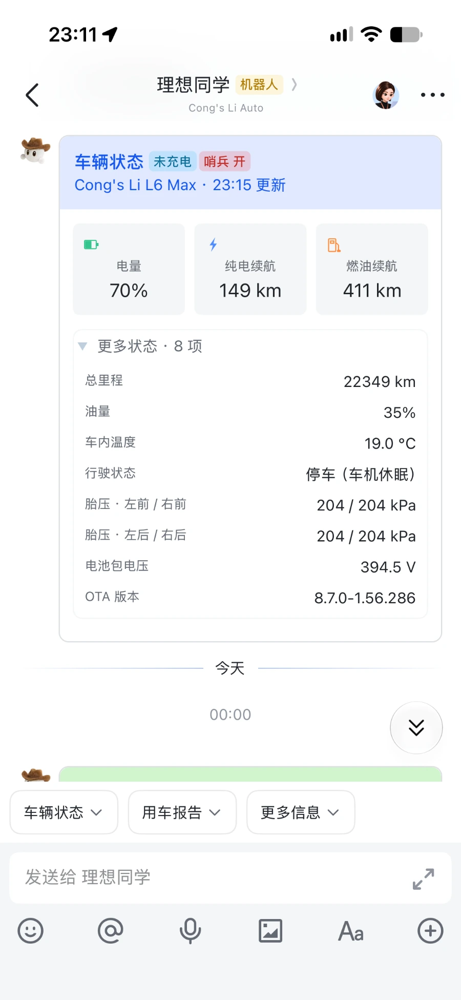
  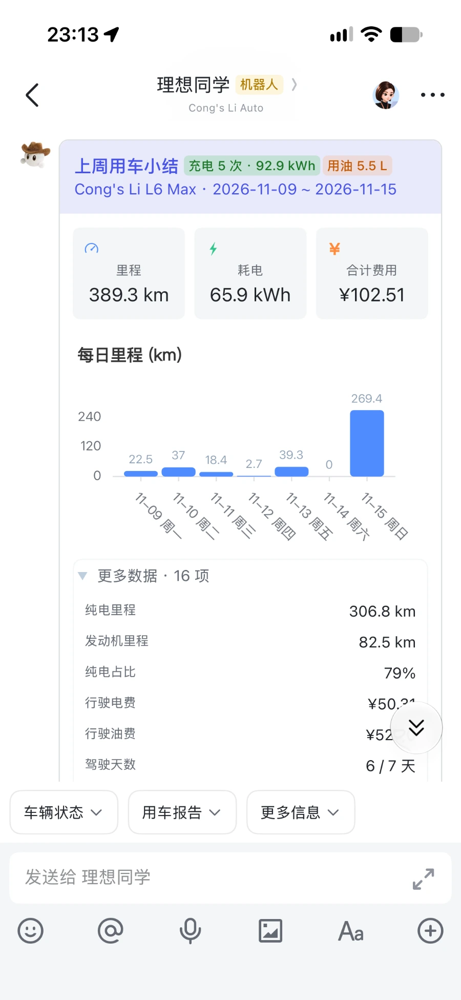
  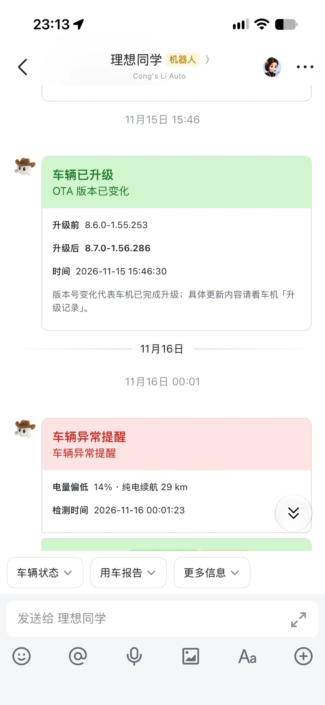
  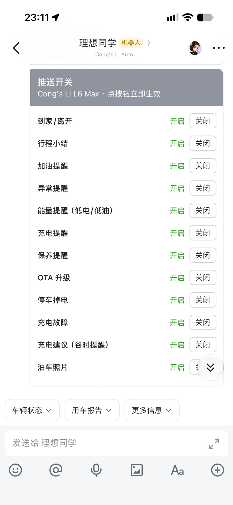
</p>
<p align="center"><sub>车辆状态（设备状态 + 充电/哨兵，展开 8 项）· 上周用车小结（柱图 + 16 项）· 车辆已升级 与 车辆异常 · 推送开关（11 项就地可点）</sub></p>

**二、出门、回家与停车**

<p align="center">
  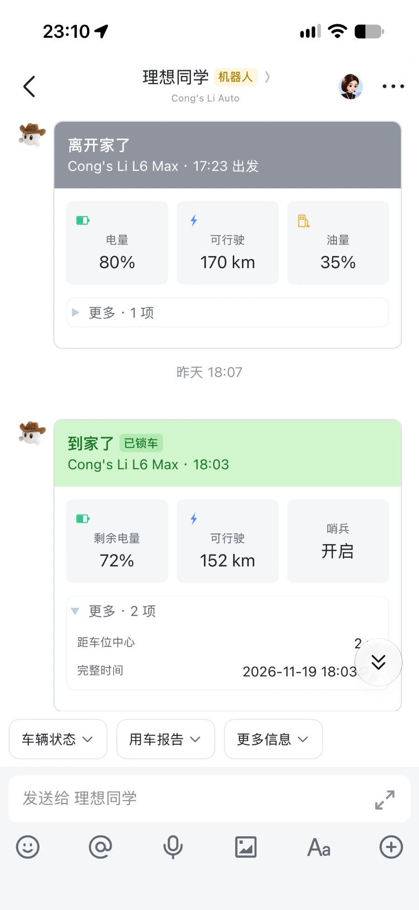
  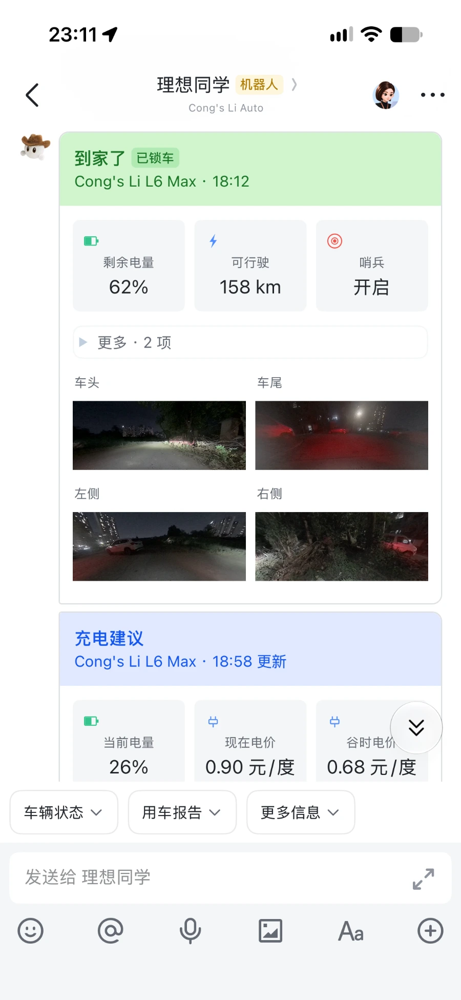
  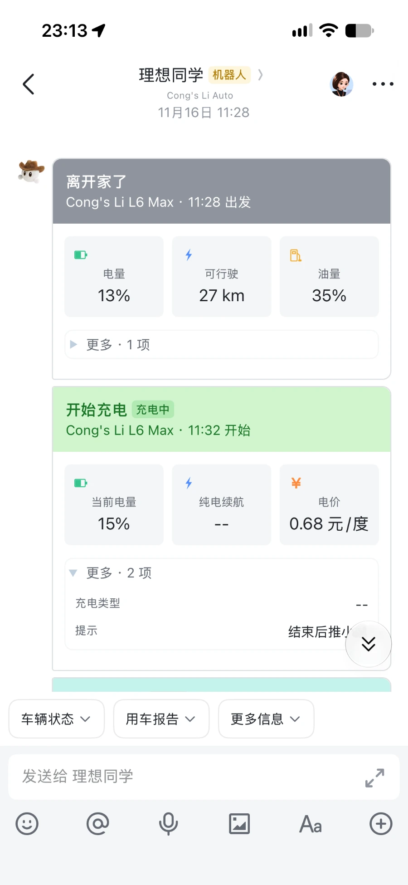
</p>
<p align="center"><sub>离开家了 + 到家了（进出围栏，连发两条）· 到家了带 4 张车机照片 · 离开家了 + 开始充电了</sub></p>

**三、补能与行程**

<p align="center">
  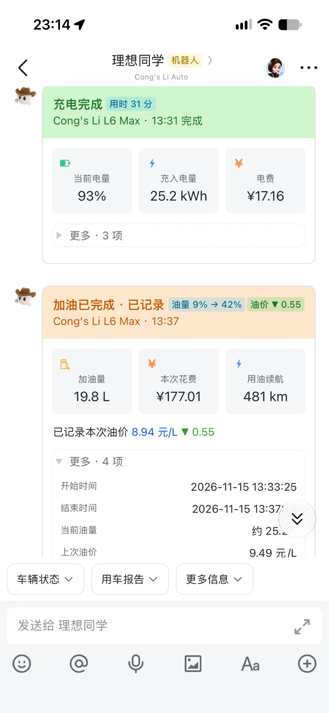
  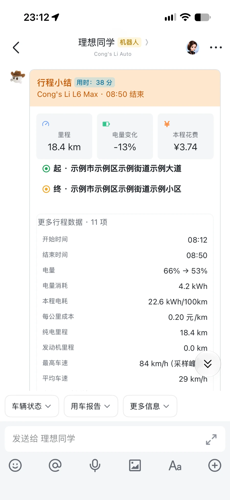
  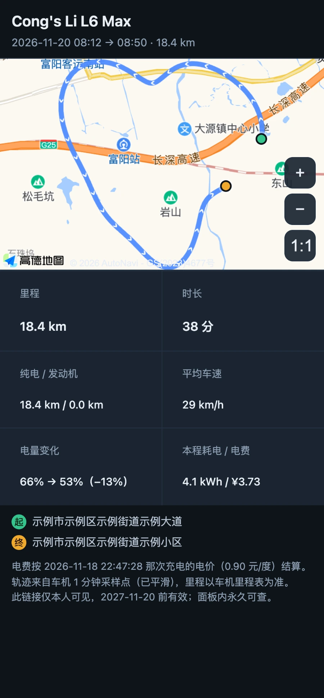
</p>
<p align="center"><sub>充电完成 + 加油已完成（加油卡里就地输价）· 行程小结（线路图 + 起终点 + 11 项）· 行程分享页（点卡片里的「查看本次线路图」，发给家人看）</sub></p>

> 截图里的车牌、地址、地图轨迹都换成了示例数据（`示例市示例区…`），和仓库里的 `sample` 数据源一致。

把 34 张卡拼在一起看是这样（真实卡片 JSON 渲染，缩略可忽略文字）：

<p align="center">
  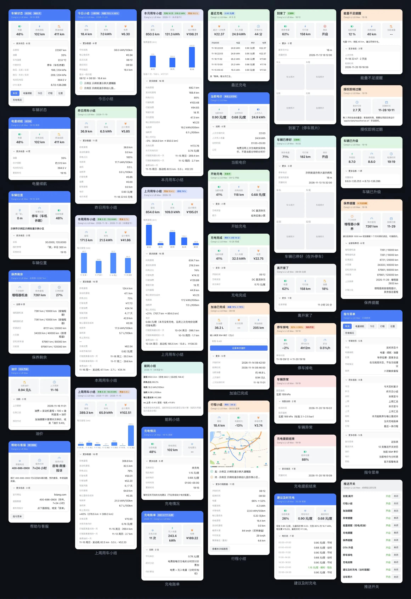
</p>

想看单张高清版：[screenshots/cards/index.html](screenshots/cards/index.html)（本地打开，按用途分 6 栏）。

---

## 三个界面

<p align="center">
  
  &nbsp;&nbsp;
  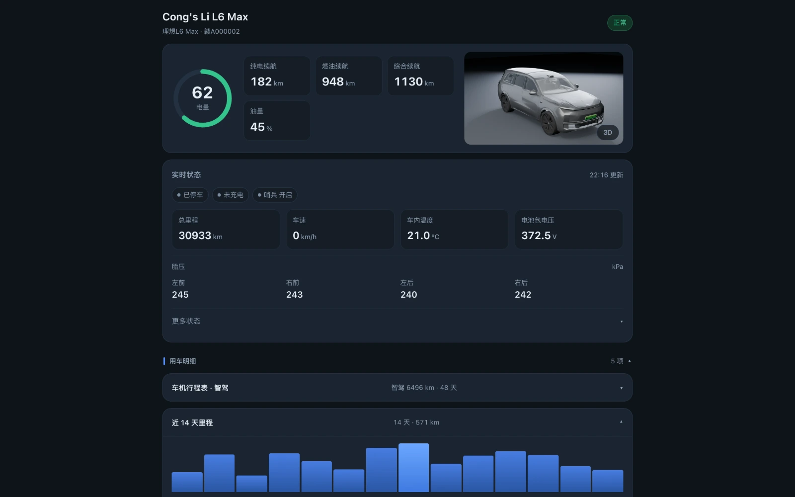
  &nbsp;&nbsp;
  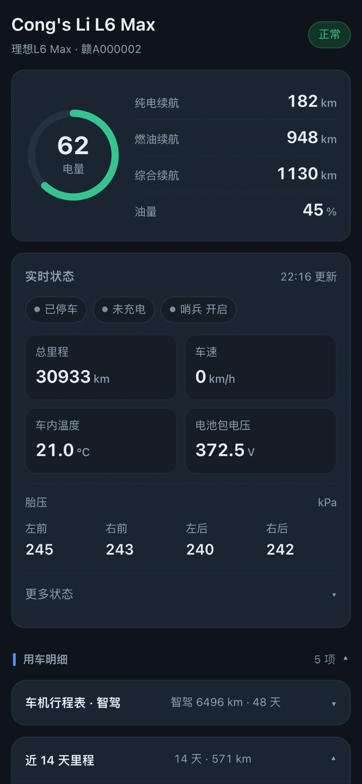
  <br>
  <sub>飞书聊天 &nbsp;·&nbsp; 网页面板（桌面 1440×900） &nbsp;·&nbsp; 网页面板（手机 390×844）</sub>
</p>

- **飞书**：推送卡进来就能看，卡片上的按钮直接回调（看线路、开关推送、输油价），底部还有 19 项常驻悬浮菜单。
- **面板** `/`：手机优先的暗色单页。首屏只放实时状态，其余 9 个区块折叠成 2 组；地图与 3D 车模点击才加载。手机整页 **1627 px ≈ 1.9 屏**（改造前 4878 px ≈ 5.8 屏）。
- **行程分享页** `/t/<token>`：给家人看「从哪到哪 + 线路图」，HMAC 签名 + 有效期，不用登录。效果见首页第 10 张真机图。

---

## 这是什么 / 不是什么

**是**：一套「个人项目级」的完整实现，从**取车况数据**到**发飞书卡片**两段全都在里面，并且把「怎么接自己的车」写成了一条能走的路径（`app/src/lib/vehicle/`）。

**不是**：开箱即用的产品。你需要一个飞书机器人应用、一个 Cloudflare 账号，以及**一条能拿到自己车辆数据的路**（见 [接入你自己的车](#接入你自己的车)）。

> 与理想汽车、飞书均无关联，非官方项目。仅用于个人学习与自用。

---

## 架构

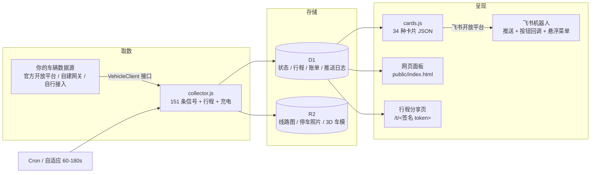

三段职责很清楚：

1. **`app/src/lib/vehicle/`** —— 唯一需要你自己动的地方。一个 7 个方法的接口，`sample` 用内置模拟数据、`custom` 由你实现。
2. **`app/src/lib/collector.js` + `cards.js`** —— 拿到数据后怎么算、怎么组织成卡片。这部分和车厂无关，全公开。
3. **`app/src/index.js`** —— HTTP 入口：飞书回调、卡片按钮、面板 API、分享页、Cron。

---

## 快速开始（不需要真车，5 分钟）

```bash
git clone <this-repo> && cd liauto-lark-push/app

npm install

# 1) 建库：把打印出来的 database_id 填进 wrangler.jsonc
npx wrangler d1 create liauto-lark-push

# 2) 建表 + 灌示例数据（45 天日汇总 / 14 条行程 / 8 次充电）
npx wrangler d1 execute liauto-lark-push --local --file=migrations/0001_init.sql
npx wrangler d1 execute liauto-lark-push --local --file=migrations/0002_feishu_webhook_log.sql
npx wrangler d1 execute liauto-lark-push --local --file=migrations/0003_trip_log.sql
npx wrangler d1 execute liauto-lark-push --local --file=migrations/0004_fuel_log.sql
npx wrangler d1 execute liauto-lark-push --local --file=scripts/seed.sql
npx wrangler d1 execute liauto-lark-push --local --file=scripts/seed-sample.sql

# 3) 配置本地变量
# wrangler.jsonc 里的 PUBLIC_BASE_URL 改成你自己的地址
cp .dev.vars.example .dev.vars     # 至少把 API_TOKEN 改掉

# 4) 跑起来
npx wrangler dev
```

打开 <http://127.0.0.1:8788/login?k=change-me> 就是面板；<http://127.0.0.1:8788/api/status> 能看到示例车况。

**没有飞书应用也能跑**：卡片会正常生成，只是发不出去（`sendMessage` 会直接跳过并返回说明）。

**部署到线上、把机器人接起来**，两条路各有一篇分步教程：

- [docs/setup-cloudflare.md](docs/setup-cloudflare.md) —— D1 / R2 / 5 个 secret / 从本地跑起来到 `wrangler deploy`、绑域名、Cron
- [docs/setup-feishu-bot.md](docs/setup-feishu-bot.md) —— 建一个飞书**机器人**、开权限、配事件订阅与回调地址、拿 Encrypt Key、配 19 项悬浮菜单

**地图需要两把高德 key**（不填则地图区域退化成占位，其它功能不受影响）：

| 用在哪 | 变量 / 位置 | 类型 |
|---|---|---|
| Worker 里逆地理、静态图 | `.dev.vars` 的 `AMAP_KEY` | Web **服务** key |
| 浏览器面板、分享页 | `app/public/app.js:364` 与 `app/src/lib/tripPage.js:84` 的 `YOUR_AMAP_JS_KEY` | Web **端(JS)** key，需配域名白名单 |
| 同上（安全密钥） | `app/public/index.html:405`、`app/src/lib/tripPage.js:83` 的 `YOUR_AMAP_SECURITY_CODE` | JS key 配套的安全密钥 |

---

## 接入你自己的车

你的车怎么把数据交出来，只有三种现实路线（详见 [docs/vehicle-data-integration.md](docs/vehicle-data-integration.md)）：

| 路线 | 适合谁 | 工作量 |
|---|---|---|
| **A. 官方开放平台 / 车厂 API**（如果有） | 有正式接口、能拿到授权的人 | 最小，按文档映射到 151 条信号 |
| **B. 自己抓自己账号的接口** | 喜欢折腾、能读懂自己 App 的人 | 中，认证与签名自己写 |
| **C. 车机 / 网关直连**（OBD、Home Assistant 中转） | 家里有网关、能实时读 CAN 的人 | 大，但最干净 |

三条路最后都收敛到同一个接口：实现 `app/src/lib/vehicle/custom.js` 里的 7 个方法，然后 `VEHICLE_PROVIDER=custom`。

```js
class MyClient {
  vin                                  // 车架号（做数据主键用）
  async getVss(paths)                  // { [path]: { value, ts } }  ← 最重要
  async travel(path)                   // 行程/日汇总原始 JSON
  async getChargeSessions(from, to)    // 充电记录
  async getChargeMonthlyStats(type)    // 月度充电统计（可选，不给就返回空）
  async credentialStatus()             // { level, days_left, ... } 凭据健康度（可选）
  async refresh()                      // 主动刷新令牌（可选，返回 false 即可）
}
```

> 信号清单在 `app/src/lib/vss-paths.js`（151 条，都在真车上验证过）。**少给几条不影响**，缺的字段卡片会显示 `--` 而不是崩。

### 给「用 AI 做这件事」的人一句话

「怎么拿到车辆数据」这半截，最省力的做法不是自己啃，而是**让你的 AI 去读一份同类开源实现**（GitHub 上能搜到几个把理想汽车接进 Home Assistant 的项目），读它的 README 与 `api` / `coordinator` 之类的文件，让它先说清四件事：**登录流程、token 怎么续、请求哪几个接口、字段怎么映射**，再回来实现 `app/src/lib/vehicle/custom.js`。这比让 AI 凭记忆猜接口可靠得多。

> 本项目**没有**复制任何同类项目的代码，也没有搬运它们的字段表：`app/src/lib/vss-paths.js` 里的 151 条路径是在自己车上实测的（一条不存在整批就 400）。具体用哪个上游项目、用不用，请你自己判断、自己承担其许可与服务条款。**真的用上了，记得回去给作者点一个 Star、留一句谢谢** —— 那类项目都是作者踩完坑无偿写出来的。

---

## 卡片清单（34 张，逐张说清什么时候来、卡里有什么）

「触发」一列要分清：**推送**是 Cron 或事件自动发的；**查询**是你发一句话（或点悬浮菜单）才回的。

20 张会自动推（其中状态、周报、月报几张同时也能用指令随时拉），14 张只在你要的时候才回——合起来去重正好 34 张。

### 状态与查询（6 张，全部发指令才回）

| # | 卡片 | 触发 | 卡里有什么 |
|---|---|---|---|
| 01 | 车辆状态 | 发「状态」 | 电量、纯电续航、燃油续航三块 + 未充电/哨兵两个标签 + 6 个快捷按钮 |
| 02 | 电量续航 | 发「电量」 | 电量百分比、纯电/燃油续航、充电状态 |
| 03 | 车辆位置 | 发「位置」 | 距家、距公司两个距离 + 停车状态 + 逆地理地址；**不含精确坐标** |
| 04 | 保养剩余 | 发「保养」 | 增程器机油、空调滤芯的剩余里程与百分比（按各自周期算） |
| 05 | 油价 | 发「油价」 | 92/95/98 三档价格 + 与上次调整的差额 |
| 06 | 帮助与客服 | 发「帮助」 | 客服电话、常见问题、投诉入口 |

### 用车报告（7 张：2 张自动推 + 5 张查询）

| # | 卡片 | 触发 | 卡里有什么 |
|---|---|---|---|
| 07 | 今日小结 | 发「今天」 | 今天 00:00 到此刻的实时累计 |
| 08 | 昨日用车小结 | 每天早上 07:30–07:40 自动推 | 昨日里程、花费、电耗、油耗三块 + 折叠 11 项细账（含每日里程柱图） |
| 09 | 本周用车小结 | 周一早上自动推 / 发「本周」 | 本周累计里程与充电度数 + 每日里程柱图 |
| 10 | 上周用车小结 | 发「上周」 | 上周完整数据：里程、电量、费用 + 柱图 + 折叠 16 项 |
| 11 | 本月用车小结 | 每月 1 日自动推 / 发「月报」 | 本月累计里程与花费 + 每日里程柱图 + 折叠细账 |
| 12 | 上月用车小结 | 发「上月」 | 上月完整数据（跨月补账用） |
| 13 | 能耗小结 | 发「能耗」 | 百公里电耗/油耗、纯电占比、与官方口径的差 |

> 09–13 是同一个构造器按周期参数出的，配色与折叠项数随周期变。

### 充电与补能（7 张）

| # | 卡片 | 触发 | 卡里有什么 |
|---|---|---|---|
| 14 | 充电情况 | 发「充电」 | 当前电量、已充度数、预计充满时间、当前功率 |
| 15 | 充电账单 | 发「账单」 | 本月充电次数、度数、金额三块 + 折叠（每次时间与花费） |
| 16 | 最近充电 | 发「充电流水」 | 最近多次充电：时间、度数、金额 + 单价 |
| 17 | 当前电价 | 发「电价」 | 上次充电**实际结算**的单价与度数 + 7 段分时电价表 |
| 18 | 开始充电 | 插枪开始充时自动推 | 当前电量、预计充满、当前电价档位 |
| 19 | 充电完成 | 拔枪结束充电时自动推 | 充入度数、花费、时长 + 电量从多少到多少 |
| 20 | 加油已完成 | 加完油自动推 | 加油量、金额、加油站；卡内带输入框，输单价可原地重算 |

### 行程与停车（5 张，全部自动推）

| # | 卡片 | 触发 | 卡里有什么 |
|---|---|---|---|
| 21 | 行程小结 | 每趟行程结束 | 里程、电量变化、花费三块 + 起终点两行 + 「查看本次线路图」按钮 + 折叠 11 项（起止时间、电耗、最高/平均车速…） |
| 22 | 到家了 | 进入「家」围栏 | 电量、续航、哨兵状态 + 车机自动拍的 4 张照片（车头/车尾/左侧/右侧） |
| 23 | 车辆已停好 | 在**外面**停车 | 同上但不带照片，改为「停车地点 + 距家的距离」 |
| 24 | 离开家了 | 驶出「家」围栏（须先通知过「到家」） | 出发时间、电压、续航 + **在家停留 11 小时 20 分** |
| 25 | 停车掉电 | 停车期间掉电 ≥2% | 掉了多少 %、多少 kWh、每小时多少 |

### 提醒与告警（7 张，只在真发生时才推）

| # | 卡片 | 触发 | 卡里有什么 |
|---|---|---|---|
| 26 | 车辆异常 | 胎压低于 190 kPa 等真实故障 | 异常项与实测值、检测时间（低电/低油不在这里，见 29） |
| 27 | 充电提前结束 | 充电中途断掉 | 充到多少 %、中断时间 |
| 28 | 建议及时充电 | 在家 + 未充电 + 电量 ≤30% + 当前非谷时（每天最多 1 次） | 当前电价与最低电价 + 7 段分时表 + 什么时候充最便宜 |
| 29 | 能量不足提醒 | 电量或油量偏低 | 哪一项低、低到多少、建议补电还是就近加油 |
| 30 | 授权即将过期 | 凭据剩余不足 7 天 | 还剩几天、到期时间、重新授权三步 |
| 31 | 车辆已升级 | OTA 版本号变化 | 从哪个版本 → 到哪个版本、升级时间 |
| 32 | 保养提醒 | 剩余里程 ≤1500 km（≤500 km 升级为红） | 到期项、剩余里程/天数 + 折叠六项保养台账（同档 30 天内不重复） |

### 指令与设置（2 张）

| # | 卡片 | 触发 | 卡里有什么 |
|---|---|---|---|
| 33 | 指令菜单 | 发「菜单」 | 全部指令清单 + 六项常驻菜单说明 |
| 34 | 推送开关 | 发「推送」 | 11 个开关，**卡片里直接点开/关**，不用改配置 |

> 上面是文档序号；`screenshots/cards/` 里的文件编号是出图顺序，两套不完全对应。
> 另有纯文本回执（按钮点完的 toast）与飞书**常驻悬浮菜单 19 项**，每项直达一张卡。

**卡片是数据驱动的**：全部由 `cards.js` 的 `cardShell(...)` 生成 JSON 2.0，改文案不用碰 UI。

---

## 面板与行程分享页

- **面板** `/`：语义色令牌 + 原生 JS，首屏字节比改造前 **−95.5%**；实时状态分主/次两级并可展开；9 个明细区块折叠成 2 组；高德脚本改为**点击才加载**（首屏第三方请求 3 → 0，整页字节 −86%）。
- **行程分享页** `/t/<token>`：高德底图 + 折线 + 起终点，支持双指缩放（整页不跟着放大）；`?embed=1` 是给卡片出图用的无边框模式。
- **登录**：`/login?k=<API_TOKEN>` 写一个一年期 cookie，之后直接访问域名即可。

---

## 目录结构

```
app/
  src/
    index.js            # HTTP 入口：飞书回调、卡片按钮、面板 API、分享页、Cron
    lib/
      vehicle/          # ★ 唯一的接入点：sample / custom
      collector.js      # 取数 → 计算 → 落库（151 条信号、行程、充电、围栏进出）
      cards.js          # 推送卡的 JSON 构造（20 张）
      commands.js       # 20 条文本指令 → 14 张查询卡
      tripPage.js       # 行程分享页（高德底图 + 折线 + 嵌入截图模式）
      pushswitch.js     # 11 个推送开关
      reminders.js      # 保养 / OTA / 掉电 / 充电故障检测
      util.js           # 上海时区解析（Worker 是 UTC，必须走这里）
  public/               # 面板（无框架，原生 JS）
  migrations/           # D1 建表
  scripts/              # 种子数据、车模海报渲染
assets/                 # 图标、3D 车模（GLB）、署名文件
docs/                   # 接入说明 + 两篇部署教程 + 发布计划
screenshots/real/       # 手机真实截屏（webp）
screenshots/cards/      # 34 张卡片渲染图 + 总览页
screenshots/maps/       # 行程线路图
tools/                  # 卡片渲染器、脱敏检查、总览页生成
```

---

## 踩过的坑（真实遇到过，写下来省你时间）

1. **Worker 是 UTC**：`new Date("2026-11-20 08:00:00")` 会被当 UTC 解析，差 8 小时。全部走 `parseShanghai()`。
2. **Free 套餐 CPU 10ms**：别在 Worker 里做图片编码/压缩，一定 1102。出图一律走 Browser Rendering。
3. **D1 状态是整包快照**：`runtime_state` 里的 detail 是**整个对象**存一次，只取几个字段再写回会把其余字段清空。
4. **卡片回调必须 3 秒内返回 200**：回调分支里不要 `await` 任何网络请求，先 200 再后台做。
5. **VSS 信号要批量取**：一次要 151 条可以，混进一条不存在的整批 400。
6. **飞书的折叠面板默认收起**：想让人看见的内容别放进折叠区。
7. **同一信息别写两遍**：标题写了「14 天 · 684 km」，正文就别再写一遍，否则手机上全是重复数字。
8. **地图脚本会阻塞首屏**：高德主包 111 KB，普通 `<script>` 会把后面所有数据接口推迟 2 秒；改点击懒加载后首屏字节 −86%。
9. **模块顶层别取时间**：Workers 模块顶层 `Date.now()` 返回 0，会让「运行时长」算出天文数字——一律在函数内取。
10. **卡片 JSON 里的字号/颜色有两个位置**：有的写在元素上，有的写在 `text` 子对象里，做预览渲染器时两种都要读。

---

## License

- 代码：[MIT](LICENSE)
- 3D 车模：**CC BY 4.0**，原作者与来源见 [assets/public/car-license.txt](assets/public/car-license.txt)（务必保留署名）
- 第三方声明：[NOTICE](NOTICE)

## 致谢

- [Cloudflare Workers / D1 / R2](https://developers.cloudflare.com/) —— 整套后端就在这里跑
- [飞书开放平台](https://open.feishu.cn/) —— 卡片 JSON 2.0 与机器人
- [高德地图 JS API](https://lbs.amap.com/) —— 线路图与逆地理
- 3D 车模模型作者 MattDoesBlender（Sketchfab）
